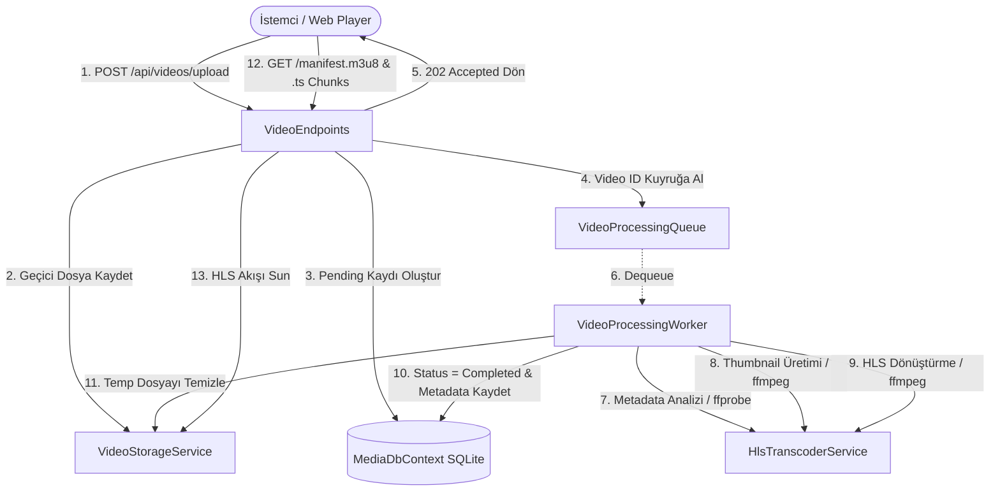

# Laf.CourseService - Video & HLS Streaming Servisi

Bu servis; kullanıcıların video yüklemesini kabul eden, yüklenen videoları arka planda asenkron olarak analiz edip (**FFprobe**) poster görseli çıkaran ve HTTP Live Streaming (**HLS** / `.m3u8` & `.ts`) formatına dönüştüren (**FFmpeg**), ardından yüksek performanslı HTTP akışı (streaming) ve önbellekleme sunan modern bir **.NET 9 Minimal API** mikroservisidir.

---

## 🏗️ Genel Mimari ve İşleyiş Şeması



---

## 📁 Proje Dizin Yapısı

```plaintext
Laf.CourseService/
├── BackgroundJobs/
│   ├── VideoProcessingQueue.cs       # Bellek içi kanal (Channel) tabanlı iş kuyruğu
│   └── VideoProcessingWorker.cs      # Arka plan video işleme servisi (IHostedService)
├── Data/
│   └── MediaDbContext.cs             # EF Core SQLite veritabanı bağlamı
├── Endpoints/
│   └── VideoEndpoints.cs             # Minimal API route ve endpoint tanımları
├── Models/
│   ├── UploadVideoRequest.cs         # Video yükleme istek ve kabul yanıt modelleri
│   ├── VideoMetadata.cs              # Video veritabanı entity'si ve durum enum'ı
│   ├── VideoProbeResult.cs           # FFprobe analiz sonuç DTO'su
│   └── VideoResponseDto.cs           # İstemcilere sunulan video detay yanıt modeli
├── Services/
│   ├── HlsTranscoderService.cs       # FFmpeg & FFprobe CLI transcoding implementasyonu
│   ├── IHlsTranscoderService.cs      # Transcoder servis sözleşmesi (Interface)
│   ├── IVideoStorageService.cs       # Disk depolama servis sözleşmesi (Interface)
│   ├── MediaStorageOptions.cs        # appsettings.json depolama konfigürasyon sınıfı
│   └── VideoStorageService.cs        # Fiziksel dosya ve klasör yönetim implementasyonu
├── Storage/
│   ├── ProcessedHls/                 # İşlenmiş HLS klasörleri ({videoId}/master.m3u8 + segmentler)
│   └── TempUploads/                  # İlk yüklenen ham geçici videolar
├── Program.cs                        # Uygulama başlangıç noktası ve DI konfigürasyonu
└── appsettings.json                  # Uygulama ayarları
```

---

## 🧩 Sınıf ve Bileşenlerin Detaylı Açıklamaları

### 1. `Program.cs`
* **Görevi:** Uygulamanın giriş noktasıdır (Entry Point).
* **Temel İşlevleri:**
  - **Servis Kayıtları (Dependency Injection):** `MediaStorageOptions`, `MediaDbContext`, `VideoProcessingQueue`, `IVideoStorageService`, `IHlsTranscoderService` ve `VideoProcessingWorker` servislerini DI konteynerine kaydeder.
  - **Büyük Dosya Yükleme Limitleri:** Kestrel sunucusu ve form body sınırlarını 500 MB boyutundaki videoları kabul edecek şekilde yapılandırır (`MaxRequestBodySize`, `MultipartBodyLengthLimit`).
  - **CORS Desteği:** Video.js, HLS.js, Plyr gibi harici web tabanlı oynatıcıların videolara sorunsuz erişebilmesi için tam CORS izni tanır.
  - **Veritabanı İlklendirmesi:** SQLite veritabanını (`media_stream.db`) otomatik olarak oluşturur (`EnsureCreated`) ve eksik olabilecek kolon migrasyonlarını uygular.
  - **Endpoint Eşleştirme:** Minimal API endpoint'lerini (`MapVideoEndpoints`) ve OpenAPI dokümantasyonunu devreye alır.

---

### 2. `Data/MediaDbContext.cs`
* **Görevi:** Entity Framework Core tabanlı veritabanı yönetim sınıfıdır (`DbContext`).
* **Temel İşlevleri:**
  - `Videos` (`DbSet<VideoMetadata>`) tablosunu yönetir.
  - `OnModelCreating` metodunda; `OriginalFileName`, `ContentType`, `Resolution`, `VideoCodec`, `AudioCodec`, `UploadedBy`, `UploaderId`, `HlsMasterPlaylistPath` ve `ThumbnailPath` gibi alanların maksimum karakter sınırlarını ve kısıtlamalarını tanımlar.
  - Sık sorgulanan `Status` ve `CreatedAt` kolonları üzerinde veritabanı indeksleri (`HasIndex`) oluşturarak sorgu performansını optimize eder.

---

### 3. Models

#### 3.1. `Models/VideoMetadata.cs`
* **`VideoProcessingStatus` (Enum):**
  - Videonun işleme yaşam döngüsünü belirtir:
    - `Pending (0)`: Video yüklendi, sıraya alındı, işlenmeyi bekliyor.
    - `Processing (1)`: Video worker tarafından alındı, FFprobe analizi ve FFmpeg dönüştürmesi devam ediyor.
    - `Completed (2)`: HLS formatına başarıyla dönüştürüldü ve oynatmaya hazır.
    - `Failed (3)`: İşlem sırasında bir hata oluştu.
* **`VideoMetadata` (Class):**
  - Veritabanında kalıcı olarak saklanan ana video varlığıdır (Entity).
  - Dosya boyutu, oynatma süresi (`DurationSeconds`), çözünürlük (`Width`, `Height`, `Resolution`), codec bilgileri (`VideoCodec`, `AudioCodec`), bitrate, fps ve yükleyen kullanıcı bilgilerini tutar.
  - İşlem tamamlandığında üretilen `HlsMasterPlaylistPath` ve `ThumbnailPath` fiziksel yollarını saklar.

#### 3.2. `Models/UploadVideoRequest.cs`
* **`UploadVideoRequest` (Class):**
  - `multipart/form-data` üzerinden gelen dosya yükleme istek modelidir.
  - `VideoFile` (`IFormFile`), `UploadedBy` (yükleyen kullanıcı adı) ve `UploaderId` (kullanıcı kimliği) alanlarını barındırır.
* **`VideoUploadAcceptedResponse` (Class):**
  - Video başarıyla sunucuya ulaştığında ve kuyruğa alındığında istemciye dönülen HTTP 202 Accepted yanıt modelidir.
  - `VideoId`, `Message`, `Status` ve istemcinin durumu kontrol edebileceği `StatusUrl` bilgisini içerir.

#### 3.3. `Models/VideoProbeResult.cs`
* **`VideoProbeResult` (Class):**
  - FFprobe aracının ham JSON çıktısından ayrıştırılan teknik video özet modelidir.
  - Süre, genişlik, yükseklik, format etiketi (örn: `1920x1080 (1080p)`), video ve ses codec'leri, bitrate ve kare hızını (`FrameRate`) temsil eder.

#### 3.4. `Models/VideoResponseDto.cs`
* **`VideoResponseDto` (Class):**
  - İstemcilere API sorgularında dönülen Data Transfer Object (DTO) modelidir.
  - `FromEntity(VideoMetadata entity, string baseUrl)` statik metodu sayesinde entity verisini DTO'ya dönüştürür.
  - Video tamamlandığında doğrudan oynatıcıya verilebilecek `ManifestUrl` (`/api/videos/{id}/manifest.m3u8`) ve `ThumbnailUrl` (`/api/videos/{id}/thumbnail`) mutlak adreslerini otomatik olarak üretir.

---

### 4. BackgroundJobs (Arka Plan İşlemleri)

#### 4.1. `BackgroundJobs/VideoProcessingQueue.cs`
* **Görevi:** Bellek içi, yüksek performanslı ve asenkron görev kuyruğudur.
* **Temel İşlevleri:**
  - `System.Threading.Channels` kütüphanesinin sınırsız kanalını (`Channel.CreateUnbounded<Guid>`) kullanır.
  - `SingleReader = true` optimizasyonu ile tek bir iş parçacığı tarafından güvenle ve minimum CPU/bellek maliyetiyle okunacak şekilde kurgulanmıştır.
  - `QueueVideoAsync`: Yüklenen videonun `Guid` değerini kuyruğa yazar.
  - `DequeueVideoAsync`: Worker için sıradaki videoyu asenkron olarak bekler ve getirir.

#### 4.2. `BackgroundJobs/VideoProcessingWorker.cs`
* **Görevi:** `BackgroundService` sınıfından türetilen ve uygulama çalıştığı sürece arka planda yaşayan işçi servisidir (`IHostedService`).
* **Temel İşlevleri:**
  - `ExecuteAsync` döngüsü içinde `VideoProcessingQueue`'dan gelen videoları dinler.
  - Sıradaki video geldiğinde yeni bir DI Scope (`CreateScope`) oluşturur ve `MediaDbContext`, `IVideoStorageService`, `IHlsTranscoderService` servislerini çözer.
  - **İşlem Adımları:**
    1. Veritabanında durumunu `Processing` olarak günceller.
    2. Geçici yükleme dosyasını bulur ve doğrular.
    3. `ProbeVideoAsync` ile video meta verilerini (çözünürlük, codec, süre vb.) çıkarıp veritabanına işler.
    4. `GenerateThumbnailAsync` ile videonun ilk saniyelerinden poster kapak görseli (`thumbnail.jpg`) çıkarır.
    5. `TranscodeToHlsAsync` ile videoyu HLS segmentlerine (`.ts`) ve master playlist'e (`master.m3u8`) dönüştürür.
    6. Veritabanında durumunu `Completed` olarak günceller ve `CompletedAt` tarihini atar.
    7. Disk alanını korumak için ilk yüklenen geçici dosyayı temizler (`CleanupTempFile`).
  - Olası bir hata anında hatayı loglar, durumu `Failed` yapar ve `ErrorMessage` alanına hatayı kaydeder.

---

### 5. Services (İş Mantığı ve Depolama)

#### 5.1. `Services/MediaStorageOptions.cs`
* **Görevi:** `appsettings.json` içindeki `MediaStorage` yapılandırma bölümünü temsil eden seçenekler (Options Pattern) sınıfıdır.
* **Özellikleri:**
  - `BasePath`: Depolama ana dizini (varsayılan: `Storage`).
  - `TempUploadsFolder`: Geçici yüklemelerin tutulduğu klasör adı (`TempUploads`).
  - `ProcessedHlsFolder`: İşlenmiş HLS çıktılarının tutulduğu klasör adı (`ProcessedHls`).
  - `MaxFileSizeBytes`: Kabul edilen maksimum dosya boyutu (varsayılan: `524,288,000` byte / 500 MB).
  - `FfmpegPath` / `FfprobePath`: Çalıştırılabilir ikili dosyaların yolları veya komut adları.
  - `AllowedExtensions`: İzin verilen video formatları (`.mp4`, `.mov`, `.avi`, `.mkv`, `.webm`).

#### 5.2. `Services/IVideoStorageService.cs`
* **Görevi:** Dosya sistemi ve depolama işlemlerini soyutlayan arayüzdür.
* **Metotları:**
  - `EnsureDirectoriesCreated()`: Gerekli depolama dizinlerini doğrular ve oluşturur.
  - `SaveTemporaryUploadAsync(...)`: Yüklenen videoyu geçici klasöre kaydeder.
  - `GetTempFilePath(...)` / `FindExistingTempFilePath(...)`: Geçici dosyanın yolunu bulur.
  - `GetProcessedHlsDirectory(...)`: Videoya özel HLS klasör yolunu verir (`Storage/ProcessedHls/{id}`).
  - `GetMasterPlaylistPath(...)`: `master.m3u8` dosya yolunu döner.
  - `GetThumbnailPath(...)`: `thumbnail.jpg` dosya yolunu döner.
  - `GetSegmentPath(...)`: İstenen `.ts` parçasının yolunu verir.
  - `SegmentExists(...)`, `MasterPlaylistExists(...)`, `ThumbnailExists(...)`: Dosyaların varlığını kontrol eder.
  - `CleanupTempFile(...)`: Geçici dosyayı siler.
  - `DeleteProcessedHls(...)`: Videonun tüm işlenmiş HLS dizinini siler.
  - `DeleteAll()`: Tüm geçici ve işlenmiş dosyaları diskten siler.

#### 5.3. `Services/VideoStorageService.cs`
* **Görevi:** `IVideoStorageService` arayüzünün fiziksel disk implementasyonudur.
* **Önemli Noktaları:**
  - `IWebHostEnvironment` kullanarak kök dizine bağlı göreceli veya mutlak dosya yollarını güvenli bir şekilde hesaplar.
  - `GetSegmentPath` metodunda `Path.GetFileName` kullanarak **Directory Traversal** (Dizin Atlama) güvenlik zafiyetlerini engeller.
  - Asenkron dosya akışları (`FileStream`, 80 KB arabellek) kullanarak sunucu belleğini tüketmeden disk yazma işlemlerini tamamlar.
  - `DeleteAll` ve `CleanupTempFile` fonksiyonlarında hata fırlatmayan korumalı temizlik (best-effort cleanup) yaklaşımı uygular.

#### 5.4. `Services/IHlsTranscoderService.cs`
* **Görevi:** Video işleme, analiz ve dönüştürme operasyonlarını tanımlayan arayüzdür.
* **Metotları:**
  - `ProbeVideoAsync(...)`: Videonun codec, süre, çözünürlük vb. bilgilerini analiz eder.
  - `GenerateThumbnailAsync(...)`: Videodan 1 adet JPEG formatında kapak görseli çıkarır.
  - `TranscodeToHlsAsync(...)`: Videoyu HLS segmentlerine ve manifest dosyasına kodlar.

#### 5.5. `Services/HlsTranscoderService.cs`
* **Görevi:** `IHlsTranscoderService` arayüzünün `CliWrap` tabanlı dış süreç (external process) implementasyonudur.
* **Önemli Yetenekleri:**
  - **Dinamik Exe Çözümleme (`ResolveExecutable`):** Windows ortamında WinGet, Chocolatey ve Program Files dizinlerini tarayarak sistem PATH ortamında FFmpeg kurulu olmasa dahi doğru `ffmpeg.exe` ve `ffprobe.exe` dosyalarını otomatik olarak bulur.
  - **FFprobe Entegrasyonu (`ProbeVideoAsync`):** `-print_format json` argümanıyla video akışını inceler ve `ParseProbeJson` metodu ile kesirli kare hızlarını (örn. `30000/1001` -> `29.97 fps`), çözünürlük etiketlerini (örn. `1080p`, `4K`), video/ses codec'lerini JSON olarak parse eder.
  - **Thumbnail Çıkarma (`GenerateThumbnailAsync`):** Videonun 1. saniyesinden (`-ss 00:00:01`) yüksek kaliteli tek bir kare alır (`-vframes 1 -q:v 2`). Süresi 1 saniyeden kısa videolarda otomatik olarak 0. saniyeye fallback yapar.
  - **HLS Transcoding (`TranscodeToHlsAsync`):**
    - Video Codec: `libx264` (CRF: 22, Preset: `fast`)
    - Ses Codec: `aac` (Bitrate: `128k`)
    - Segment Süresi: `-hls_time 6` (6 saniyelik `.ts` parçaları)
    - Oynatma Listesi Türü: `-hls_playlist_type vod` (Video on Demand)
    - Çıktı: `master.m3u8` ve `segment_%03d.ts` dosyaları.

---

### 6. Endpoints

#### 6.1. `Endpoints/VideoEndpoints.cs`
* **Görevi:** Video operasyonlarına yönelik tüm HTTP rotalarını Minimal API mimarisiyle tanımlayan statik sınıftır (`MapVideoEndpoints`).
* **Kapsanan Endpoint'ler:**

| Metot | Rota | Açıklama | Yanıt Kodu |
| :--- | :--- | :--- | :--- |
| `POST` | `/api/videos/upload` | Video dosyasını yükler, doğrular, diske kaydeder ve arka plan HLS kuyruğuna ekler. | `202 Accepted` / `400 Bad Request` |
| `GET` | `/api/videos/{id}` | Belirtilen videonun meta verilerini ve işlem durumunu döner. | `200 OK` / `404 Not Found` |
| `GET` | `/api/videos` | Yüklenmiş videoları sayfalanmış (paginated) olarak listeler (`page`, `pageSize`). | `200 OK` |
| `GET` | `/api/videos/{id}/manifest.m3u8` | HLS oynatma listesini (`application/vnd.apple.mpegurl`) döner. HTTP 60sn Cache-Control başlığı içerir. | `200 OK` / `409 Conflict` / `404 Not Found` |
| `GET` | `/api/videos/{id}/{segmentName}` | HLS video parçasını (`video/mp2t`) sunar. Değişmez önbellekleme (`immutable, max-age=1 yıl`) uygular. | `200 OK` / `404 Not Found` |
| `GET` | `/api/videos/{id}/segments/{segmentName}` | HLS parçası için alternatif segment rotası. | `200 OK` / `404 Not Found` |
| `GET` | `/api/videos/{id}/thumbnail` | Videonun kapak görselini (`image/jpeg`) sunar. 24 saat önbelleklenir. | `200 OK` / `404 Not Found` |
| `DELETE` | `/api/videos/{id}` | Videonun veritabanı kaydını, geçici yükleme dosyasını ve HLS klasörünü tamamen siler. | `204 NoContent` / `404 Not Found` |
| `DELETE` | `/api/videos/all` | Tüm videoları veritabanından ve diskten toplu olarak temizler (Bakım/Test amaçlı). | `200 OK` |

---

## 🚀 Özet ve Tasarım Desenleri (Design Patterns)

Proje modern kurumsal yazılım prensiplerine uygun olarak tasarlanmıştır:
1. **Producer-Consumer Pattern (`Channel<T>`):** Yükleme işlemi istemciyi bekletmez; HTTP 202 dönülerek işlem arka plan iş parçacığına devredilir.
2. **Options Pattern (`IOptions<MediaStorageOptions>`):** Yapılandırma ayarları tip güvenli (strongly-typed) olarak sınıflara enjekte edilir.
3. **Repository / Unit of Work Mantığı (EF Core):** SQLite üzerinde veriler asenkron olarak yönetilir.
4. **Separation of Concerns (SoC):** Veri katmanı (`Data`), sunum katmanı (`Endpoints`), iş mantığı (`Services`), arka plan işleri (`BackgroundJobs`) ve veri modelleri (`Models`) birbirinden tam olarak izole edilmiştir.
5. **Streaming & Caching Optimization:** Video parçaları (`.ts`) byte-range ve immutable cache desteği ile sunularak bant genişliği ve sunucu CPU yükü en aza indirilmiştir.
