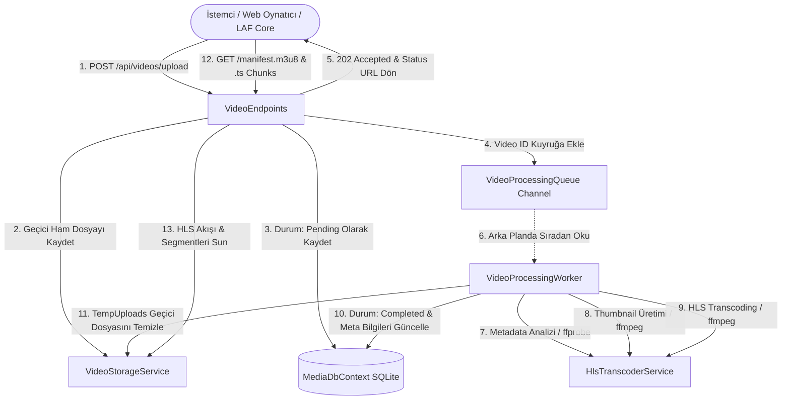

# 🎬 LAF Course Service - Yüksek Performanslı Video & HLS Streaming Mikroservisi

**LAF Course Service**, büyük boyutlu video dosyalarının sisteme yüklenmesini sağlayan, yüklenen videoları arka planda asenkron işleyerek **FFprobe** ile zengin teknik üst verilerini (metadata) çıkaran, **FFmpeg** ile otomatik kapak görseli (thumbnail) oluşturan ve **HTTP Live Streaming (HLS / `.m3u8` & `.ts`)** formatına dönüştüren yüksek performanslı bir **.NET 10 Minimal API** servisidir.

Bu servis; video oynatıcılar (Video.js, HLS.js, Plyr vb.), mobil cihazlar (iOS/Android Safari, VLC) ve web uygulamaları için optimize edilmiş akış (streaming), bayt aralığı (byte-range) istekleri ve önbellekleme (caching) altyapısı sunar.

---

## 🏗️ Genel Mimari ve İşleyiş Şeması



---

## 📁 Proje Dizin Yapısı

```plaintext
laf-course-service/
├── publish.bat                           # IIS dağıtımını otomatik hale getiriyor. development ortamı için
├── publish.ps1                           # IIS AppPool durduran, projeyi derleyen ve yayınlayan PowerShell scripti
├── README.md                             # Proje ana dokümantasyonu
└── src/
    └── Laf.CourseService/
        ├── BackgroundJobs/
        │   ├── VideoProcessingQueue.cs   # Bellek içi kanal (Channel) tabanlı asenkron iş kuyruğu
        │   └── VideoProcessingWorker.cs  # Arka planda HLS dönüştürmeyi yöneten IHostedService
        ├── Data/
        │   └── MediaDbContext.cs         # Entity Framework Core SQLite veritabanı bağlamı
        ├── Endpoints/
        │   ├── TestPlayerHtml.cs         # Dahili HLS test ve oynatıcı kontrol paneli (HTML/CSS/JS)
        │   └── VideoEndpoints.cs         # Minimal API uç nokta (route) tanımları
        ├── Exceptions/
        │   ├── ExceptionMiddleware.cs    # Global merkezi hata yakalama middleware'i
        │   └── ErrorModel/
        │       └── ErrorDetails.cs       # Standart hata yanıt modeli
        ├── Models/
        │   ├── UploadVideoRequest.cs     # Video yükleme istek ve kabul yanıt DTO modelleri
        │   ├── VideoMetadata.cs          # Veritabanı video varlığı (Entity) ve işlem durumu enum'ı
        │   ├── VideoProbeResult.cs       # FFprobe teknik analiz sonuç modeli
        │   └── VideoResponseDto.cs       # İstemcilere dönülen video detay ve URL yanıt DTO'su
        ├── Services/
        │   ├── HlsTranscoderService.cs   # FFmpeg ve FFprobe CLI çalıştırma & dönüştürme servisi
        │   ├── IHlsTranscoderService.cs  # Video transkoder servis arayüzü
        │   ├── IVideoStorageService.cs   # Fiziksel disk depolama servis arayüzü
        │   ├── MediaStorageOptions.cs    # appsettings.json depolama ve FFmpeg ayar sınıfı
        │   └── VideoStorageService.cs    # Fiziksel dosya okuma/yazma ve temizlik servisi
        ├── Storage/                      # Yerel depolama dizini (Git'e eklenmez)
        │   ├── ProcessedHls/             # İşlenmiş HLS klasörleri ({VideoId}/master.m3u8, segmentler, thumbnail)
        │   └── TempUploads/              # İlk yüklenen geçici ham video dosyaları
        ├── appsettings.json              # Uygulama konfigürasyonu
        ├── Program.cs                    # Minimal API başlangıç noktası, DI ve middleware konfigürasyonu
        └── web.config                    # IIS In-Process barındırma, 500MB sınır ve MIME türleri
```

---

## 🧩 Sınıfların ve Bileşenlerin Detaylı İncelemesi

Projedeki her bir dosya, sınıf ve arayüzün üstlendiği sorumluluklar aşağıda ayrıntılı olarak açıklanmıştır:

### 1. Giriş ve Başlangıç Katmanı

#### `Program.cs`
* **Görevi:** Uygulamanın başlangıç noktasıdır (Entry Point).
* **Temel Sorumlulukları:**
  - **Servis Kayıtları (Dependency Injection):** `MediaStorageOptions` konfigürasyonunu bağlar; `MediaDbContext` (SQLite), `VideoProcessingQueue` (Singleton), `IVideoStorageService` (Singleton), `IHlsTranscoderService` (Scoped) ve `VideoProcessingWorker` (HostedService) bileşenlerini kaydeder.
  - **Büyük Dosya Limitleri (500 MB):** Kestrel (`MaxRequestBodySize`), IIS In-Process (`IISServerOptions`) ve Form kısıtlamalarını (`MultipartBodyLengthLimit`) 500 MB olarak ayarlar.
  - **Önbellek (Memory Cache):** HLS isteklerinde `HIT` / `MISS` takibi yapabilmek için `IMemoryCache` servisini etkinleştirir.
  - **CORS Desteği:** Video.js, Plyr veya HLS.js gibi harici alan adlarından gelen istemcilerin video oynatabilmesi için tam CORS izni sağlar ve `X-Cache-Status`, `Content-Range`, `Accept-Ranges` başlıklarını dışarıya açar.
  - **Veritabanı Başlatma:** Uygulama ayağa kalkarken `media_stream.db` SQLite veritabanının ve tablolarının otomatik oluşturulmasını (`EnsureCreated`) sağlar.
  - **Test Kontrol Paneli ve Rotalar:** Servis durumunu dönen kök dizini (`/`), tarayıcıdan HLS testleri yapmayı sağlayan kontrol panelini (`/test`) ve tüm video uç noktalarını (`MapVideoEndpoints`) bağlar.

---

### 2. Arka Plan İşleri (BackgroundJobs)

#### `BackgroundJobs/VideoProcessingQueue.cs`
* **Görevi:** Bellek içi, yüksek performanslı ve iş parçacığı güvenli (thread-safe) asenkron görev kuyruğudur.
* **Tasarım Deseni:** **Producer-Consumer Pattern** (`System.Threading.Channels`).
* **Temel Fonksiyonları:**
  - `QueueVideoAsync(Guid videoId)`: Yüklenen videonun tekil kimliğini kanala yazar (Producer).
  - `DequeueVideoAsync(CancellationToken cancellationToken)`: Arka plan işçisinin kanaldan sıradaki videoyu asenkron olarak beklemesini ve çekmesini sağlar (Consumer).
  - `SingleReader = true` optimizasyonu ile tek bir worker tarafından minimum bellek/CPU tüketimiyle çalışır.

#### `BackgroundJobs/VideoProcessingWorker.cs`
* **Görevi:** `BackgroundService` sınıfından türetilen ve uygulama yaşam döngüsü boyunca arka planda çalışan işçi servisidir (`IHostedService`).
* **İşlem Adımları (`ProcessVideoAsync`):**
  1. Kuyruktan gelen `videoId` için yeni bir DI kapsamı (`CreateScope`) oluşturarak `MediaDbContext`, `IVideoStorageService` ve `IHlsTranscoderService` servislerini çözer.
  2. Veritabanındaki video durumunu `Processing` olarak günceller.
  3. `TempUploads` altındaki ham geçici video dosyasını doğrular.
  4. `ProbeVideoAsync` ile videoyu analiz eder; süre, çözünürlük, en-boy, codec, bitrate ve FPS değerlerini entity'ye kaydeder.
  5. Eğer kullanıcı yükleme esnasında özel bir kapak görseli vermemişse, `GenerateThumbnailAsync` ile videodan otomatik 1 adet poster kapak görseli (`thumbnail.jpg`) çıkarır.
  6. `TranscodeToHlsAsync` ile videoyu 6 saniyelik `.ts` segmentlerine ve `master.m3u8` oynatma listesine dönüştürür.
  7. Durumu `Completed` yapar, tamamlanma zamanını (`CompletedAt`) kaydeder.
  8. Disk alanını korumak için ilk yüklenen geçici ham video dosyasını temizler (`CleanupTempFile`).
  9. Olası bir hata durumunda durumu `Failed` yapar ve hata detayını `ErrorMessage` alanına yazar.

---

### 3. Veri Katmanı (Data)

#### `Data/MediaDbContext.cs`
* **Görevi:** Entity Framework Core tabanlı SQLite veritabanı bağlamıdır (`DbContext`).
* **Temel Fonksiyonları:**
  - `Videos` (`DbSet<VideoMetadata>`) tablosunu yönetir.
  - `OnModelCreating` metodunda; `OriginalFileName`, `ContentType`, `Resolution`, `VideoCodec`, `AudioCodec`, `UploadedBy`, `UploaderId`, `HlsMasterPlaylistPath` ve `ThumbnailPath` kolonlarının veri uzunluklarını ve zorunluluklarını sınırlar.
  - Sık sorgulanan `Status` ve `CreatedAt` kolonları üzerinde indeksler (`HasIndex`) tanımlayarak listeleme ve durum sorgularını hızlandırır.

---

### 4. Modeller ve Veri Transfer Nesneleri (Models)

#### `Models/VideoMetadata.cs`
* **`VideoProcessingStatus` (Enum):**
  - `Pending (0)`: Video yüklendi, kuyruğa alındı, işlenmeyi bekliyor.
  - `Processing (1)`: Video arka plan worker'ı tarafından alındı, FFprobe analizi ve HLS kodlaması devam ediyor.
  - `Completed (2)`: HLS dönüştürmesi başarıyla tamamlandı, oynatmaya hazır.
  - `Failed (3)`: İşlem sırasında hata oluştu.
* **`VideoMetadata` (Class):**
  - Veritabanındaki `Videos` tablosuna karşılık gelen ana varlık (Entity) sınıfıdır.
  - Dosya adı, boyutu, MIME türü, çözünürlüğü, süresi, video/ses codec'i, bitrate, FPS, yükleyen bilgisi, master playlist dosya yolu ve thumbnail dosya yolunu saklar.

#### `Models/UploadVideoRequest.cs`
* **`UploadVideoRequest`:** Çok parçalı form verisi (`multipart/form-data`) üzerinden gelen istek modelidir. `VideoFile`, opsiyonel `ThumbnailFile`, `UploadedBy` ve `UploaderId` alanlarını içerir.
* **`VideoUploadAcceptedResponse`:** Video sunucuya yüklenip işleme kuyruğuna alındığında istemciye dönülen `202 Accepted` yanıt modelidir (`VideoId`, `Message`, `Status`, `StatusUrl`).

#### `Models/VideoProbeResult.cs`
* **Görevi:** FFprobe tarafından ayrıştırılan teknik video özetini temsil eden DTO sınıfıdır (`DurationSeconds`, `Width`, `Height`, `Resolution`, `VideoCodec`, `AudioCodec`, `Bitrate`, `FrameRate`, `FileSizeBytes`).

#### `Models/VideoResponseDto.cs`
* **Görevi:** API üzerinden istemcilere sunulan temiz video detay DTO modelidir.
* **Önemli Mantığı (`FromEntity`):** Video tamamlanmışsa (`Completed`), doğrudan oynatıcılarda kullanılabilecek mutlak akış bağlantılarını (`ManifestUrl`: `/api/videos/{id}/manifest.m3u8` ve `ThumbnailUrl`: `/api/videos/{id}/thumbnail`) dinamik olarak oluşturur.

---

### 5. İş Mantığı ve Depolama Servisleri (Services)

#### `Services/MediaStorageOptions.cs`
* **Görevi:** `appsettings.json` içerisindeki `MediaStorage` yapılandırma bölümünü eşleyen **Options Pattern** sınıfıdır.
* **Alanları:** `BasePath`, `TempUploadsFolder`, `ProcessedHlsFolder`, `MaxFileSizeBytes`, `FfmpegPath`, `FfprobePath` ve `AllowedExtensions`.

#### `Services/IVideoStorageService.cs` & `Services/VideoStorageService.cs`
* **Görevi:** Fiziksel disk üzerindeki klasör hiyerarşisini, dosya okuma/yazma ve temizlik operasyonlarını yöneten servistir.
* **Temel Yetenekleri:**
  - `EnsureDirectoriesCreated()`: `Storage`, `Storage/TempUploads` ve `Storage/ProcessedHls` dizinlerinin varlığını garanti eder.
  - `SaveTemporaryUploadAsync(...)`: Yüklenen ham videoyu 80 KB arabellekli akış (`FileStream`) ile diske yazar.
  - `GetSegmentPath(...)`: İstenen `.ts` dosyasının fiziksel yolunu dönerken `Path.GetFileName` kullanarak **Directory Traversal** (Dizin Atlama) güvenlik zafiyetlerini engeller.
  - `SaveCustomThumbnailAsync(...)`: Kullanıcının sağladığı özel kapak görselini kaydeder.
  - `CleanupTempFile(...)` & `DeleteProcessedHls(...)`: Geçici dosyaları veya tamamlanmış HLS klasörünü diskten siler.
  - `DeleteAll()`: Bakım veya temizlik amacıyla tüm geçici ve işlenmiş dosyaları diskten güvenle siler.

#### `Services/IHlsTranscoderService.cs` & `Services/HlsTranscoderService.cs`
* **Görevi:** **CliWrap** kütüphanesi aracılığıyla FFmpeg ve FFprobe süreçlerini (process) yöneten, video analiz ve HLS dönüştürme motorudur.
* **Temel Yetenekleri:**
  - **Akıllı Çalıştırılabilir Dosya Çözümleme (`ResolveExecutable`):** FFmpeg ve FFprobe'un sistemdeki konumunu otomatik olarak keşfeder.
  - `ProbeVideoAsync(...)`: FFprobe ile videoyu inceleyerek JSON çıktısından çözünürlük etiketi (örn. `1080p`, `4K`), kesirli kare hızı (örn. `30000/1001` -> `29.97 FPS`), süre ve codec verilerini ayrıştırır.
  - `GenerateThumbnailAsync(...)`: Videonun 1. saniyesinden (`-ss 00:00:01`) yüksek kaliteli tek bir kare alır; kısa videolarda otomatik olarak 0. saniyeye geri düşer (fallback).
  - `TranscodeToHlsAsync(...)`: Videoyu çok çekirdekli optimizasyon ile HLS standardına dönüştürür.

---

### 6. Uç Noktalar ve Arayüz (Endpoints)

#### `Endpoints/VideoEndpoints.cs`
* **Görevi:** Minimal API mimarisiyle video yönetiminin tüm HTTP uç noktalarını tanımlar.
* **Sunduğu Uç Noktalar:**
  1. `POST /api/videos/upload`: Video dosyasını ve opsiyonel kapak resmini doğrular, diske kaydeder ve arka plan kuyruğuna ekler (`202 Accepted`).
  2. `PUT /api/videos/{id}/thumbnail`: Var olan bir videoya sonradan özel kapak görseli yükler.
  3. `GET /api/videos/{id}`: Videonun durumunu, teknik üst verilerini ve akış URL'lerini döner.
  4. `GET /api/videos`: Yüklenen videoları sayfalanmış (paginated: `page`, `pageSize`) olarak listeler.
  5. `GET /api/videos/{id}/manifest.m3u8`: HLS master oynatma listesini döner (`application/vnd.apple.mpegurl`).
  6. `GET /api/videos/{id}/{segmentName}` ve `GET /api/videos/{id}/segments/{segmentName}`: `.ts` parçalarını `video/mp2t` türünde sunar. Değişmez önbellekleme (`Cache-Control: public, max-age=31536000, immutable`) ve bayt aralığı (byte-range) destekler.
  7. `GET /api/videos/{id}/thumbnail`: Kapak görselini (`image/jpeg`) sunar.
  8. `DELETE /api/videos/{id}`: Videoyu veritabanından, geçici yükleme dosyasından ve HLS dizininden tamamen siler.
  9. `DELETE /api/videos/all`: Tüm verileri ve dosyaları topluca temizler.

#### `Endpoints/TestPlayerHtml.cs`
* **Görevi:** Tarayıcı üzerinden doğrudan video yükleme, yükleme durumunu gerçek zamanlı izleme, metadata detaylarını görme ve **Hls.js** entegrasyonu ile videoları anında oynatma imkanı sunan modern, gömülü bir test kontrol panelidir (`/test`).

---

### 7. Hata Yönetimi (Exceptions)

#### `Exceptions/ExceptionMiddleware.cs` & `Exceptions/ErrorModel/ErrorDetails.cs`
* **Görevi:** Uygulama genelinde fırlatılabilecek beklenmeyen istisnaları merkezi olarak yakalar ve istemciye standart JSON formatında (`StatusCode`, `Message`) yanıt döner.

---

## ⚙️ FFmpeg Yapılandırması ve Çalışma Mantığı

Bu servisin video işleme yetenekleri doğrudan **FFmpeg** ve **FFprobe** CLI araçlarına dayanır.

### 1. Sistemde Kurulum Yöntemleri
FFmpeg ve FFprobe'un sunucuda veya geliştirici makinesinde kurulu olması gerekir:
* **Windows (WinGet):**
  ```powershell
  winget install Gyan.FFmpeg
  ```
* **Windows (Chocolatey):**
  ```powershell
  choco install ffmpeg
  ```
* **Windows Server & IIS (Önerilen Manuel Kurulum):**
  FFmpeg dosyalarını `C:\ffmpeg\bin` klasörüne kopyalayınız (`C:\ffmpeg\bin\ffmpeg.exe` ve `C:\ffmpeg\bin\ffprobe.exe`).
* **Linux (Ubuntu / Debian):**
  ```bash
  sudo apt update && sudo apt install -y ffmpeg
  ```

### 2. Akıllı Exe Bulma Hiyerarşisi (`ResolveExecutable`)
`HlsTranscoderService`, FFmpeg ve FFprobe çalıştırılabilir dosyalarını ararken şu hiyerarşik sırayı takip eder:
1. `appsettings.json` içinde tanımlı `FfmpegPath` veya `FfprobePath` (eğer doğrudan dosya mevcutsa),
2. `C:\ffmpeg\bin\ffmpeg.exe` (Windows Server & IIS ortamları için özel ayrılmış standart dizin),
3. WinGet paket dizini (`%USERPROFILE%\AppData\Local\Microsoft\WinGet\Packages\**\ffmpeg.exe`),
4. Chocolatey dizini (`C:\ProgramData\chocolatey\bin\ffmpeg.exe`),
5. Program Files dizini (`C:\Program Files\ffmpeg\bin\ffmpeg.exe`),
6. Sistem ortam değişkenleri (`PATH`).

### 3. `appsettings.json` Konfigürasyonu
```json
{
  "MediaStorage": {
    "BasePath": "Storage",
    "TempUploadsFolder": "TempUploads",
    "ProcessedHlsFolder": "ProcessedHls",
    "MaxFileSizeBytes": 524288000,
    "FfmpegPath": "C:\\ffmpeg\\bin\\ffmpeg.exe",
    "FfprobePath": "C:\\ffmpeg\\bin\\ffprobe.exe",
    "AllowedExtensions": [ ".mp4", ".mov", ".avi", ".mkv", ".webm" ]
  }
}
```

### 4. Transcoding Parametreleri ve Anlamları
Servis içindeki dönüştürme işleminde kullanılan FFmpeg argümanları:
* `-codec:v libx264`: Evrensel H.264 video kodlayıcısı (tüm tarayıcı ve mobil cihazlarda doğrudan donanımsal hızlandırma destekler). (eğer video çözünürlüğü ya da sıkıştırma gibi bir  işlem yapılmayacaksa bu alanı değiştir. bu performansı arttırır ama dosya boyutu fazla olabilir.)
* `-crf 28`: Constant Rate Factor; görüntü kalitesini bozmadan dosya boyutunu ve bant genişliğini optimize eder. (eğer videolarda donma kasma vs olursa bu parametreyi 26 veya 24 e çek. hızda ufak azalma olabilir.)
* `-preset veryfast`: Kodlama süresini ciddi oranda kısaltarak CPU tüketimini düşürür. (buradaki değişiklik video kalitesinde azalma veya artmaya sebep olabilir. şuanlık veryfast iyi ama sıkıntı olursa faste çek. )
* `-threads (Cores / 2)`: Sunucudaki toplam işlemci çekirdek sayısının yarısını dinamik olarak transcoding işlemine tahsis eder (`Math.Max(1, totalCores / 2)`). Böylece hem video hızlı dönüştürülür hem de sunucunun diğer HTTP isteklerine yanıt verme kapasitesi korunur. (burayı 0 yaparsa mevcut tüm çekirdekleri kullanır.)
* `-codec:a aac -b:a 128k`: 128 kbps stereo AAC ses akışı sağlar.
* `-hls_time 6`: Videoyu 6 saniyelik parçalara böler. Hızlı başlangıç ve kararlı önbellekleme sağlar.
* `-hls_playlist_type vod`: Video on Demand (İsteğe Bağlı Video) formatında oynatma listesi oluşturur.
* `-hls_segment_filename segment_%03d.ts`: Parçaları 3 basamaklı sıra numarasıyla (`segment_000.ts`, `segment_001.ts` vb.) adlandırır.

---

## 🌐 IIS Dağıtım Detayları

### 1. IIS Barındırma (`web.config`)
Proje kökünde yer alan `web.config` dosyası şu kritik ayarları otomatik uygular:
* **In-Process Hosting:** ASP.NET Core modülü uygulama içi (in-process) çalışarak en yüksek IIS performansını sunar.
* **500 MB İstek Limiti:** IIS Request Filtering seviyesinde `maxAllowedContentLength="524288000"` tanımlanmıştır.
* **HLS MIME Eşleştirmeleri:**
  - `.m3u8` -> `application/vnd.apple.mpegurl`
  - `.ts` -> `video/mp2t`
* **İstemci Önbelleği:** Statik segment dosyaları için istemci tarafında 30 günlük önbellekleme (`clientCache`) tanımlıdır.

---

## 🔌 API Uç Noktaları Özeti

| Metot | Uç Nokta | Açıklama | Başarılı Yanıt |
|---|---|---|---|
| `POST` | `/api/videos/upload` | Video (ve opsiyonel kapak) yükler, arka plan HLS işini başlatır. | `202 Accepted` |
| `PUT` | `/api/videos/{id}/thumbnail` | Mevcut videonun kapak görselini günceller. | `200 OK` |
| `GET` | `/api/videos/{id}` | Videonun durumu, teknik özellikleri ve oynatma linklerini döner. | `200 OK` |
| `GET` | `/api/videos` | Videoları sayfalanmış olarak listeler (`page=1&pageSize=20`). | `200 OK` |
| `GET` | `/api/videos/{id}/manifest.m3u8` | HLS master playlist dosyasını sunar. | `200 OK` |
| `GET` | `/api/videos/{id}/{segmentName}` | `.ts` video parçasını byte-range ve önbellek ile sunar. | `200 OK` |
| `GET` | `/api/videos/{id}/thumbnail` | Videonun kapak resmini (`.jpg`) sunar. | `200 OK` |
| `DELETE` | `/api/videos/{id}` | Videoyu veritabanından ve diskten siler. | `204 NoContent` |
| `DELETE` | `/api/videos/all` | Tüm videoları ve dosyaları topluca siler (Bakım amaçlı). | `200 OK` |
| `GET` | `/test` | Tarayıcı tabanlı interaktif HLS test ve oynatıcı arayüzü. | `200 OK (HTML)` |

---

## 💻 Geliştirme Ortamında Çalıştırma

Projeyi yerel makinenizde başlatmak için:

```powershell
cd src/Laf.CourseService
dotnet run
```

Uygulama başladığında:
* Test Paneli: `http://localhost:5000/test`
* OpenAPI Dokümanı: `http://localhost:5000/openapi/v1.json`
* SQLite Veritabanı: `src/Laf.CourseService/media_stream.db` konumunda otomatik oluşturulacaktır.
